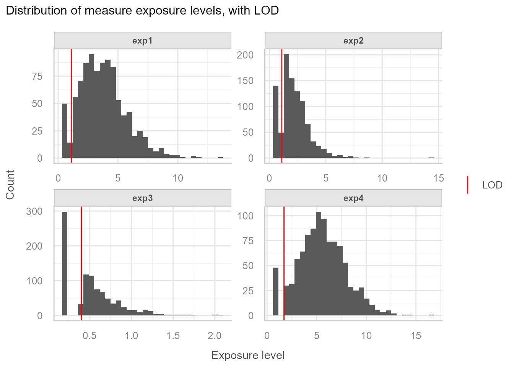
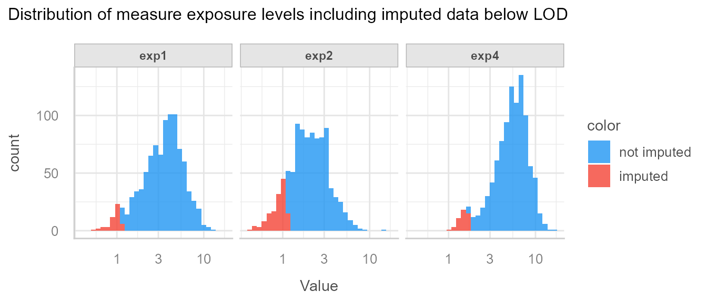
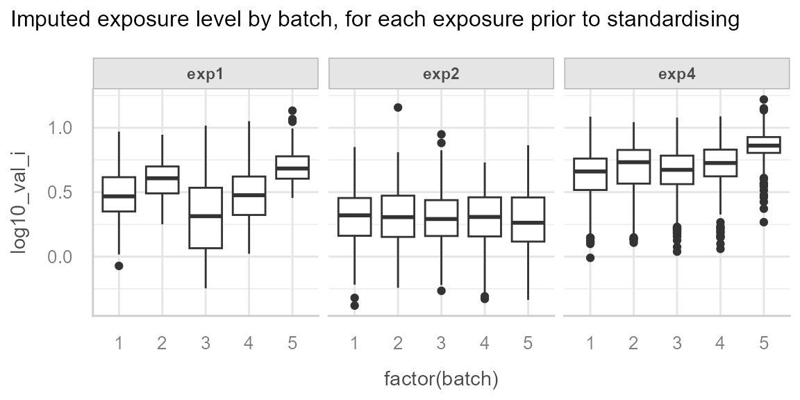
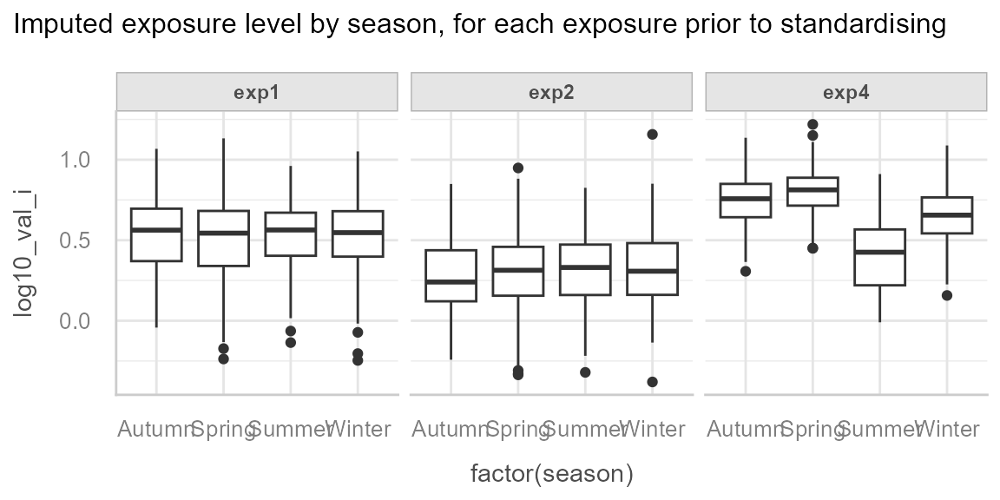
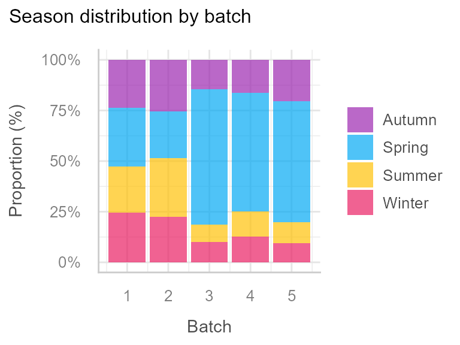
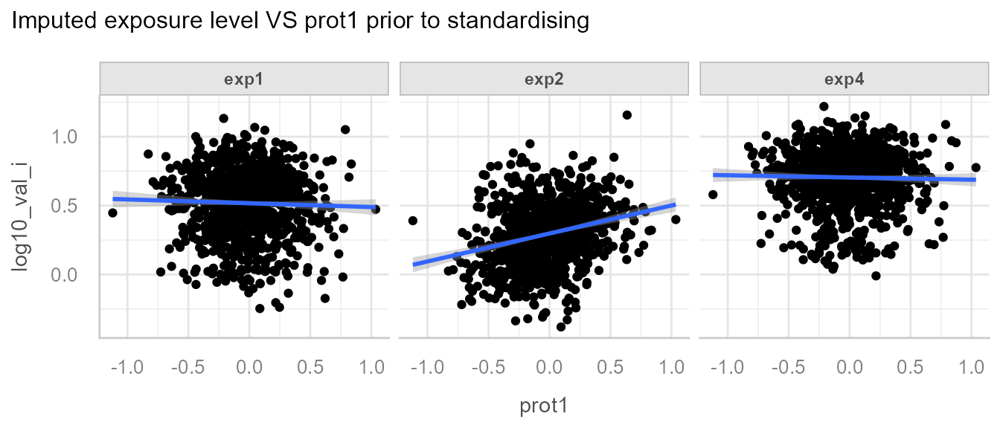
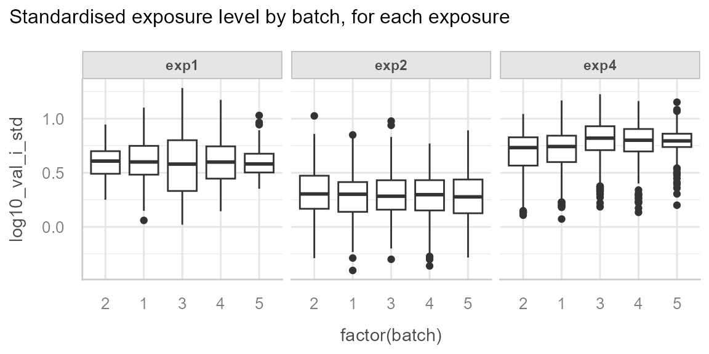
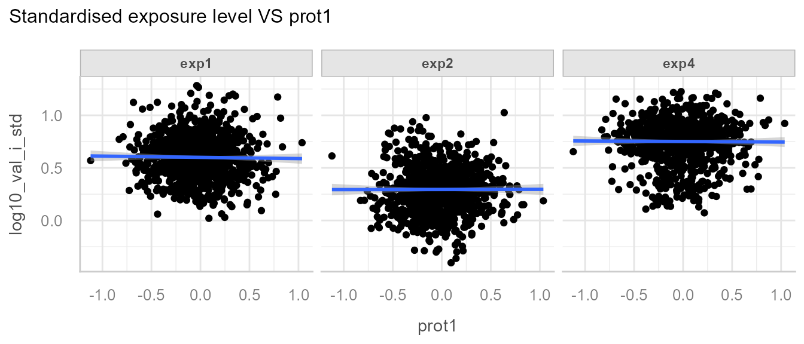

# Introduction to preprocess - package tutorial

``` r
# packages
library(dplyr)
library(ggplot2)
library(tidyr)
library(stringr)
library(readr)
library(tibble)
library(preprocess)
```

## Introduction

This vignette demonstrates the use of simulated datasets to illustrate
the application of the `fill_in` and `standardise` functions for
preprocessing environmental exposure data.

⚠️ **Important**: The `fill_in` function assumes that the variable to
impute is normally distributed. It is the user’s responsibility to apply
the appropriate transformation (e.g., log-transformation) to ensure
normality prior to using this function. The same transformation must be
applied to the Limit of Detection (LOD) to ensure consistency.

Specifically, it covers how to:

- Handle values below the Limit of Detection (LOD) using the method
  proposed by Helsel (1990). This approach accommodates one or multiple
  exposure components, each with potentially different LODs.
- Standardize exposure data by adjusting for protocol variables selected
  from a list of candidates, while also accounting for additional
  covariates, following the method of Mortamais et al. (2012).

## The Simulated Data

The datasets used in this example were designed to resemble real-world
environmental exposure data. They simulate common scenarios where LOD
handling and standardization are necessary.

``` r
# load simulated data 
data("dt_exp")
data("dt_lod")
```

The example data (`dt_exp`) consists of the following variables:

- 4 lognormally distributed exposures `exp1`, `exp2`, `exp3` and `exp4`,
  left censored (LOD), with missing data. Data below LOD is reported as
  “\<LOD”.
- `batch`, batch effect which is TRUE for `exp1` and `exp4`
- `prot1` continuous protocol variable associated with `exp2`
- `prot2` continuous protocol variable associated with none of the
  exposures
- `season`, season effect which is TRUE for `exp4`, in addition to the
  batch effect
- `cov1`, additional covariate to be included in standardisation models

Examples of candidate protocol variables include: sample transportation
time, sample defreeze time prior to measurement. Examples of additional
covariates to be included in the standardisation model include: age or
breastfeeding duration.

The data is in a wide format (one column per exposure), which is the
usual format such data is provided by analytical laboratories.

``` r
head(dt_exp)
#>     id batch             exp1             exp2              exp3       prot1
#> 1  id8     1 1.22925099690535 2.88779888466437              <LOD -0.00954975
#> 2 id14     1 4.17231182471364  3.9394983990565              <LOD -0.38237917
#> 3 id16     1 3.55763803500625 1.75607103905869 0.561280432909913 -0.59325353
#> 4 id17     1 2.25789439366093             <LOD              <LOD -0.19531902
#> 5 id22     1 6.92484889235359 1.46692222224359 0.853212096159328 -0.06349861
#> 6 id25     1 4.96218477666339 1.39213028969762              <LOD  0.36055996
#>      prot2 season             exp4         cov1
#> 1 31.35448 Autumn 3.22925099690535 -0.122238985
#> 2 47.39001 Summer 3.17231182471364 -0.042519367
#> 3 43.81518 Summer 2.55763803500625  0.005900652
#> 4 41.45147 Spring 5.25789439366093  0.330839677
#> 5 68.25540 Spring 9.92484889235359  0.034422787
#> 6 43.87650 Summer 3.96218477666339  0.241904949
```

``` r
head(dt_lod)
#>    exp lod
#> 1 exp1 1.1
#> 2 exp2 1.1
#> 3 exp3 0.4
#> 4 exp4 1.7
```

## Prepare data

Data first needs to be converted to tidy format (one row per id and per
compound, one column per variable) and LOD needs to be added in new
column:

``` r
# convert exposure to long format and add lod
dt_exp_long <- dt_exp |>
  pivot_longer(
    cols = starts_with("exp"),
    values_to = "val",
    names_to = "exp"
  ) |>
  left_join(dt_lod, by = "exp") |>
  mutate(
    val_num = ifelse(val == "<LOD", lod / 2, as.numeric(val))
  )
```

``` r
head(dt_exp_long)
#> # A tibble: 6 × 10
#>   id    batch    prot1 prot2 season    cov1 exp   val                lod val_num
#>   <chr> <int>    <dbl> <dbl> <chr>    <dbl> <chr> <chr>            <dbl>   <dbl>
#> 1 id8       1 -0.00955  31.4 Autumn -0.122  exp1  1.22925099690535   1.1    1.23
#> 2 id8       1 -0.00955  31.4 Autumn -0.122  exp2  2.88779888466437   1.1    2.89
#> 3 id8       1 -0.00955  31.4 Autumn -0.122  exp3  <LOD               0.4    0.2 
#> 4 id8       1 -0.00955  31.4 Autumn -0.122  exp4  3.22925099690535   1.7    3.23
#> 5 id14      1 -0.382    47.4 Summer -0.0425 exp1  4.17231182471364   1.1    4.17
#> 6 id14      1 -0.382    47.4 Summer -0.0425 exp2  3.9394983990565    1.1    3.94
```

## Data description

It is important to describe data prior to pre-processing.

Detection rates and basic statistics:

| Exposure | % \< LOD | p5    | Median | p95  |
|----------|----------|-------|--------|------|
| exp1     | 5%       | \<LOD | 3.55   | 7.39 |
| exp2     | 15%      | \<LOD | 2      | 4.58 |
| exp3     | 31%      | \<LOD | 0.5    | 1.16 |
| exp4     | 5%       | 1.74  | 5.44   | 9.73 |

Description of raw exposure data

Exposure level distribution:



=\> We observe different rates of data below LOD. Based on this,
exposures that are considered having too high rates of data \< LOD need
to be excluded from the imputation-standardisation process. In this
example `exp3` will be removed from any further processing and will be
categorised.

## Step 1: Fill in data below LOD

The `fill_in` function is written to be used on tidy data (one row per
id and per exposure). It is important to specify the `.by` argument of
the `mutate` call in order to separately impute data below LOD for each
group. This is important because this step requires computing exposure
specific distribution parameters, and LOD can also vary from one
exposure to another. In this simple example the only grouping variable
is the exposure, but there could be more groups on which we would like
to apply the fill-in procedure separately like exposure *and* sample
period, in which case the `.by` argument of the `mutate` call would be
modified to `.by = c(exp, period)`.

**Important**: The `fill_in` function uses the method of Helsel (1990),
which assumes that the variable to be imputed follows a **normal
distribution**. In environmental epidemiology, exposure variables are
often log-normally distributed. Therefore, the user **must apply a
log-transformation** (or another appropriate transformation) to the
variable **before** calling `fill_in`, and **must apply the same
transformation to the LOD**.

The function does not perform any transformation by itself and relies on
the user to ensure distributional assumptions are met.

Fill in is done like this:

``` r
# Impute data below LOD 
set.seed(113)
dt_imp <- dt_exp_long |>
  filter(exp != "exp3") |>
  mutate(
    log10_val_i = fill_in(
      var_to_fill = log10(val_num), # variable to be filled in, needs to be normal
      lod = log10(lod)              # variable containing LOD, needs to be same unit as variable to fill
    ),
    .by = exp
  )
```

**Important**: set a seed prior to fill-in for reproducibility.

Then systematically visualise the imputations to make sure everything
went as expected:



We see that imputed data is below LOD, and seem to have been drawn from
the correct distribution.

## Step 2: Standardise data on protocol variables

Next we want to standardise the filled-in values on protocol variables
`batch`, `prot1` and `prot2`, while taking into account the covariates
`season` and `cov1`.

We start by describing the data.

We can observe the batch effect for `exp1` and `exp4`:



And we can observe the effect of season for `exp4`:

``` r
ggplot(dt_imp, aes(x = factor(season), y = log10_val_i)) +
  geom_boxplot() +
  facet_wrap(~exp) +
  see::theme_lucid() +
  labs(
    title = "Imputed exposure level by season, for each exposure prior to standardising"
  )
```



And finally we observe an unequal distribution of season by batch:



This justifies the inclusion of `season` as a covariate in the
standardisation models, in order to differentiate the effect of `batch`
from the effect of `season`, because we want to standardise for `batch`
but not for `season`.

We can also observe the association between `exp2` and `prot1`:



The goal of the standardisation process is to detect among all the
protocol variables (`batch`, `prot1` and `prot2`) which are associated
with which exposure, and standardise each exposures for the specific
protocol to which it is associated.

The first step of the standardisation process is to define potential
protocol variables that might be associated with the variable to
standardise and the extra covariates to be included in the model:

``` r
lst_prot_vars <- c("batch", "prot1", "prot2") 
lst_cov <- c("season", "cov1")
```

Then define which are the reference values for the categorical variables
(e.g. if the reference value for batch is *batch 2*, all batches will be
“aligned” with batch 2):

``` r
# set categorical variable reference values for categorical data
dt_imp <- dt_imp |>
  mutate(
    batch = relevel(factor(batch), ref = "2"),
    season = relevel(factor(season), ref = "Spring")
  )
```

Reference value for continuous protocol variables is the median
\[@mortamais_correcting_2012\].

Once the protocol variables and the covariates have been listed and the
reference values have been set, we can apply the standardisation
function:

``` r
# Standardise 
dt_std <- dt_imp |>
  mutate(
    log10_val_i_std = standardise(
      var_to_std = "log10_val_i",               # variable to be standardised
      protocol_vars = lst_prot_vars,            # list of candidate protocol variables
      covariates = lst_cov,                     # optional list of covariates, defaults to NULL
      folder = "standardisation_outputs"        # folder where outputs are saved
    ),
    .by = exp                                   # grouping variable
  )
```

It is crucial to look at the standardisation process outputs and the
data posterior to the standardisation step to make sure what was done
matches what was expected.

All outputs are saved in the folder defined in the `path` argument.

If you want to inspect model diagnostics (linearity, residuals,
homoscedasticity, etc.), you can enable the optional argument
`export_check_model = TRUE` in the
[`standardise()`](https://mjrolland.github.io/preprocess/reference/standardise.md)
function. This will save model diagnostic plots produced by
[`performance::check_model()`](https://easystats.github.io/performance/reference/check_model.html)
in the same folder as the other outputs. This can help verify that
linear model assumptions hold for the correction models.

We can first have a look at the associated protocol variables, that were
used for the correction:

| protocol_vars | exp1    | exp2    | exp4    |
|---------------|---------|---------|---------|
| batch         | \<2e-16 | 0.42    | \<2e-16 |
| prot1         | 0.59    | 6.3e-16 | 0.91    |
| prot2         | 0.58    | 0.78    | 0.55    |

We see that the correct variables were detected.

We can see the correction for the batch effect of `exp1` and `exp4`:



We can note that there is still residual variability between batches for
`exp4`, in our case this can be explained by the `season` effect for
which we have not adjusted.

And the correction of `exp2` for `prot1`:



Note: The correction may not be so apparent, as realistic data likely
possesses greater residual variability.
